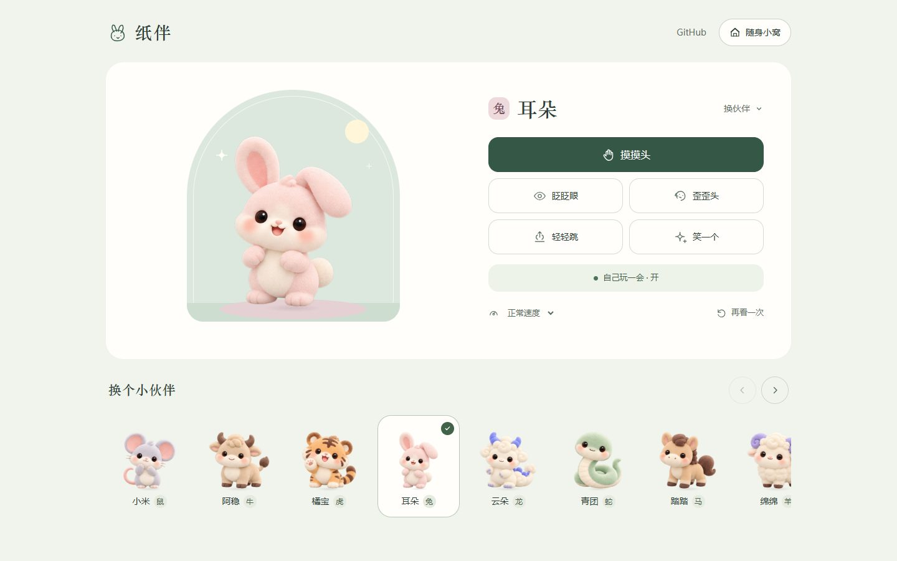
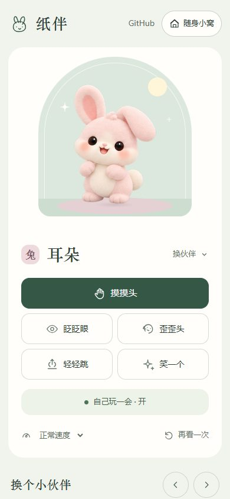

# 纸伴 PaperPal

[](https://github.com/dengjihui1/paperpal/actions/workflows/ci.yml)

住在桌面角落的十二生肖毛绒伙伴。点一点，摸摸头，陪你安静办公。



## 开始使用

准备 [Node.js 22.12 或更新版本](https://nodejs.org/)（包含 npm），动态形变与表情需要 WebGL2。Windows 与 macOS 使用同一份源码；首次运行下载依赖和 Electron，之后读取本地配置启动。

```bash
git clone https://github.com/dengjihui1/paperpal.git
cd paperpal
node setup.mjs
```

也可以选择 **Code → Download ZIP**，解压后在项目目录运行 `node setup.mjs`。Windows 可双击 `Start-PaperPal.cmd`；Mac 可运行 `bash Start-PaperPal.command`。这是终端启动的桌面程序，需要 Electron 运行时。

首次启动打开小窝，选择伙伴、昵称、身量和性格。后续启动保持小窝收起，宠物在桌面陪伴；托盘 / 菜单栏可以重新打开设置或退出。准备完成后可关闭终端。

```bash
node setup.mjs --configure       # 打开小窝设置
node setup.mjs --brand lark      # 使用 Lark 标识启动
npm run preview                 # 浏览器预览 http://127.0.0.1:4717
npm run doctor                  # 检查本机能力
```

## 能做什么

- 十二生肖自由选择，保留经典小獭；昵称、性格、颜色和身量保存在本机。
- 摸头、眨眼、歪头、小幅跳跃和开心表情；闲置时偶尔活动，可暂停。
- 保留完整毛绒角色，用连续网格形变与表情层表现轻动作。复杂趴下、起身、伸懒腰尚未开放。
- 默认身量 60%，透明区域不挡点击。可独立放在桌面，也可跟随飞书 / Lark 窗口外侧。
- 外侧优先放在窗口右下角的右边，其次下边；窗口最大化、没有容纳空间时收回托盘，恢复后再出现。

**当前是本地陪伴 MVP：不接收聊天消息，不读取聊天记录，也不自动修改飞书状态。** 无需飞书开放平台应用、企业审批或账号登录。Feishu / Lark 只用于识别客户端窗口，不代表已接入账号 API。

## 平台状态

| 能力 | Windows | macOS（Apple Silicon / Intel） |
| --- | --- | --- |
| 源码启动、定制、互动、托盘 / 菜单栏 | 本机自动验收通过 | Apple Silicon / Intel CI 通过；待实际桌面试用 |
| 窗口外侧跟随 | 原生窗口定位自动验收通过 | 合成窗口原生定位 CI 通过；真实客户端跟随仍为试用 |
| 点击穿透 | 原生窗口形状 | 区域判断单测通过；真实鼠标待实机试用 |

仓库包含 Windows、Mac Apple Silicon、Mac Intel 的 CI。CI 通过只能证明自动检查覆盖的行为，实际飞书窗口切换、多屏和系统权限仍需实机试用。详见 [平台能力](docs/platforms.md)。



## 本地数据与更新

设置保存在项目内 `.local/`，默认不上传。更新源码时保留该目录，在原目录重新运行 `node setup.mjs`；不要跨系统复制 `node_modules/`。修复依赖时运行 `node setup.mjs --repair`。

不采集聊天、截图或遥测，不向账号发送消息。[隐私说明](PRIVACY.md) 列出了窗口观察器和实验入口的范围。任意上传图片生成宠物、AI 对话及消息提醒尚未实现；目前定制使用内置角色。

## 开发与检查

```bash
npm ci
npm run check
npm test
npm run test:desktop
npm run test:setup
npm run package:source
```

源码包输出到 `dist/`，包含 Win / Mac 入口，不包含依赖、本地设置或历史设计稿。[发布说明](docs/publishing.md) · [更新记录](CHANGELOG.md)。

`desktop/` 透明窗口与 IPC；`src/` 配置、存储、平台适配；`platform/` 系统窗口观察器；`ui/` 小窝、角色和动画；`tests/` 自动验收。

## 致谢与许可

受 [feishu-pet](https://github.com/HeiGeAi/feishu-pet) 的办公宠物方向启发，本项目代码与角色独立制作。毛绒图像由生成式工具辅助创作；界面优化使用 [taste-skill](https://github.com/Leonxlnx/taste-skill)。本次界面保留原画和既有动作，统一配色、文字与控件层级。

代码使用 [MIT](LICENSE)。随仓库提供的 Three.js 遵循其 [MIT 许可](ui/vendor/THREE-LICENSE.txt)。本项目与飞书、Lark 及 Codex 官方无隶属关系。
