<div align="center">

# 绒角 MofuCorner

**给桌面一角，添一点毛茸茸。**

十二生肖毛绒桌宠 · Windows / macOS · 小邮局好友互动 · 终端启动

[](https://github.com/dengjihui1/mofu-corner/actions/workflows/ci.yml)
[](LICENSE)
[](https://nodejs.org/)

[快速开始](#快速开始) · [看看互动](#摸摸它它会回应) · [桌面小窝](#把伙伴放到桌面上) · [小邮局](#小邮局让伙伴替你捎个信) · [飞书 / Lark](#和飞书--lark-一起使用) · [常见问题](#常见问题)

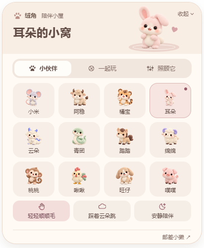 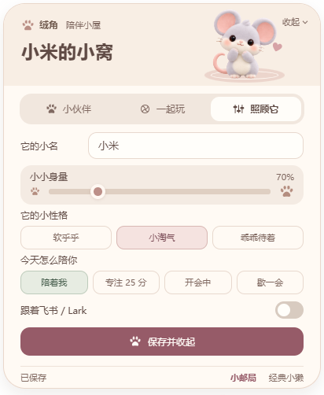

</div>

绒角是一款用源码启动的桌面陪伴程序。选一位生肖伙伴，给它起个小名，放在桌面角落；忙的时候安静守候，闲下来就摸摸头、歪歪头，或者轻轻跳一下。

它使用独立透明窗口，支持桌面自由摆放，也支持停在飞书 / Lark 窗口外侧。默认身量 **60%**，可以拖动、调大小、切换性格，设置保存在本机。

> **默认本地陪伴，社交按需连接。** 小邮局已提供独立账号、好友私聊和宠物互动，可自行部署公开注册服务；当前没有预置的官方公共服务器。飞书 / Lark 仅做窗口陪伴，不读取它们的聊天消息，也不修改账号状态。Mac 真实客户端跟随仍为试用功能。

<details>
<summary>看看窄窗口预览</summary>

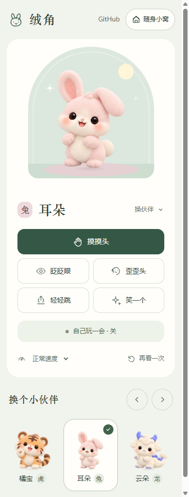

</details>

## 快速开始

### 需要准备什么

| 项目 | 要求 |
| --- | --- |
| 系统 | Windows 10 / 11；macOS 12 或更新版本，Apple Silicon / Intel |
| Node.js | **22.12 或更新版本**，安装包须包含 npm：[官网下载](https://nodejs.org/) |
| 图形环境 | 本机图形桌面与 WebGL2；动态形变、眼部表情依赖图形渲染 |
| 网络 | 首次准备需能访问 npm 与 Electron 下载源；依赖安装完成后，本地陪伴无需账号网络服务 |
| Git | 用克隆方式下载时需要；也可下载 ZIP，解压后使用 |
| 飞书 / Lark | 独立桌面陪伴不需要安装；窗口外侧陪伴需要对应桌面客户端正在运行 |

系统下限依据当前锁定的 Electron 43 运行时；CI 覆盖 Windows、macOS 15 的 Apple Silicon 与 Intel。其他系统版本、真实多屏和窗口切换仍需试用。[平台能力与验收](docs/platforms.md) · [Electron 平台说明](https://www.electronjs.org/docs/latest/breaking-changes)

### 下载，然后运行

```bash
git clone https://github.com/dengjihui1/mofu-corner.git
cd mofu-corner
node setup.mjs
```

`setup.mjs` 会检查环境、准备依赖与 Electron，并启动桌宠。**第一次启动会打开小窝；以后读取已保存的配置，保持小窝收起。** 下载速度取决于网络，准备过程可能需要几分钟。

不使用 Git：点击仓库右上角 **Code → Download ZIP**，解压，进入包含 `setup.mjs` 的目录，在终端运行 `node setup.mjs`。

| 启动方式 | Windows | macOS |
| --- | --- | --- |
| 通用终端入口 | `node setup.mjs` | `node setup.mjs` |
| 随附脚本 | 双击 `Start-MofuCorner.cmd` | 在项目目录运行 `bash Start-MofuCorner.command` |
| 再次打开设置 | `node setup.mjs --configure` | `node setup.mjs --configure` |

准备完成后可以关闭终端，宠物会继续运行。退出请使用托盘 / 菜单栏中的 **退出**。

### 要部署服务器吗

直接在自己的 Windows 或 Mac 上运行即可。默认陪伴不需要云服务器、数据库、域名、Docker、模型 API Key 或飞书开放平台配置。Electron 是自动准备的桌面运行时，程序会在本机启动透明窗口；当前未提供商店客户端或全局 npm 安装包。

## 摸摸它，它会回应

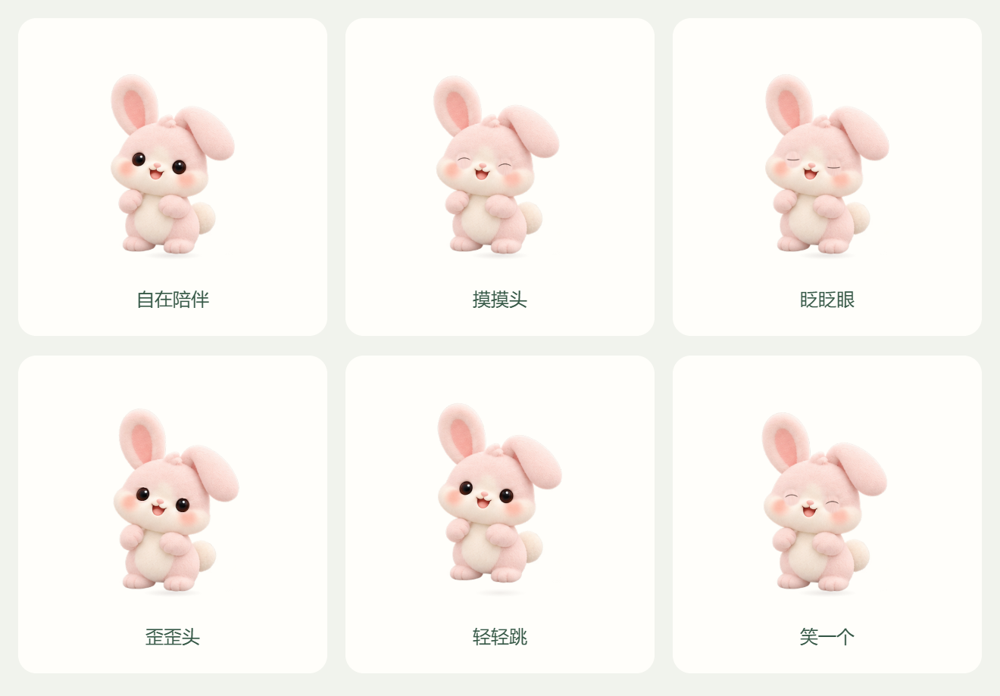

上图是原渲染器的动作关键帧，完整动作在程序中连续播放。保留同一张毛绒原画，动作与表情幅度都较轻。

| 互动 | 如何使用 | 伙伴的回应 |
| --- | --- | --- |
| 摸摸头 | 点击桌宠或小窝顶部的伙伴；预览中也可点“摸摸头” | 小幅靠近、开心眼神与脸颊变化 |
| 眨眨眼 | 小窝 → 一起玩 → 眨眨眼 | 闭眼，再自然睁开 |
| 歪歪头 | 点击“歪歪头” | 头部轻偏，身体与耳朵小幅跟随 |
| 轻轻跳 | 点击“轻轻跳” | 预备、短暂腾空、落地回稳；小蛇使用开心回应 |
| 笑一个 | 点击“笑一个” | 弯弯的眼睛与轻微身体回应 |
| 闲置陪伴 | 保持陪伴模式 | 偶尔看看、眨眼、歪头；节奏受性格影响 |
| 安静陪伴 | 点击角色面板中的“安静陪伴” | 保持原画安静守候，再点宠物恢复陪伴 |
| 暂停与慢放 | 小窝 → 一起玩 → 小动作已开启可暂停；预览支持 0.6×；专注 / 会议模式会安静下来 | 减少打扰；尊重系统“减少动态”偏好 |

复杂的连续趴下、起身和伸懒腰身体动画尚未开放；小游戏里的“舒展条”是滑动玩法，不表示已实现完整伸懒腰动画。

## 十二生肖，十二位小伙伴

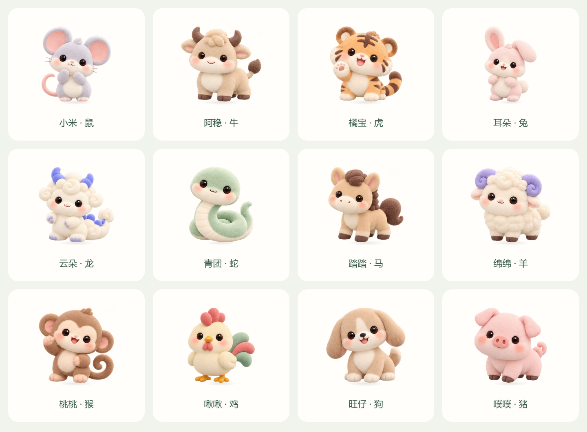

| 生肖 | 小名 | 玩具抽屉里的玩法 |
| --- | --- | --- |
| 鼠 | 小米 | 找到三颗谷粒 |
| 牛 | 阿稳 | 轻推三次靠垫 |
| 虎 | 橘宝 | 碰碰小爪，完成三次击掌 |
| 兔 | 耳朵 | 依次点亮三朵小云 |
| 龙 | 云朵 | 收集三朵小云 |
| 蛇 | 青团 | 滚动小球，先到左端、再到右端 |
| 马 | 踏踏 | 点三次，陪它小踏步 |
| 羊 | 绵绵 | 跟随呼吸节奏放松 |
| 猴 | 桃桃 | 点开叶子，找到躲起来的桃桃 |
| 鸡 | 啾啾 | 按左、右、左的顺序回应 |
| 狗 | 旺仔 | 抛三次小球给它 |
| 猪 | 噗噗 | 慢慢拉动舒展条到终点 |

这些玩法提供进度和文字回应，共用当前可用的轻动作；不代表每只角色都已具备完整的专属骨骼动画。经典小獭 **折折** 也保留在小窝底部，属于可切换的角色；好友与聊天从独立的“小邮局”入口打开。

<details>
<summary><strong>展开查看全部十二生肖小游戏截图</strong></summary>

<table>
<tr><td align="center"><strong>小米 · 找谷粒</strong><br>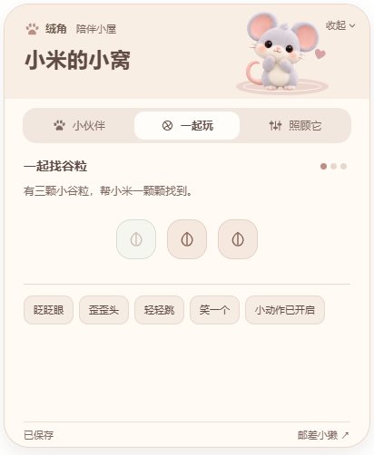</td><td align="center"><strong>阿稳 · 推靠垫</strong><br>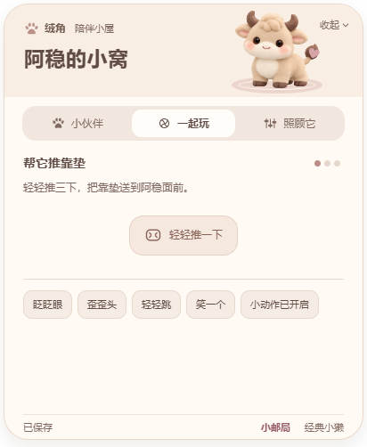</td></tr>
<tr><td align="center"><strong>橘宝 · 小爪击掌</strong><br>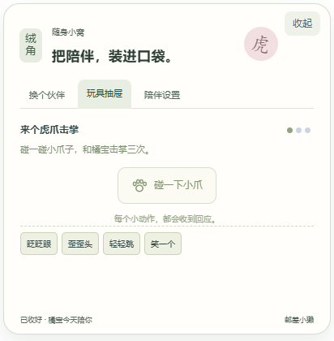</td><td align="center"><strong>耳朵 · 点亮小云</strong><br>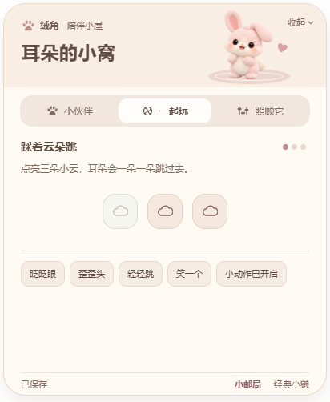</td></tr>
<tr><td align="center"><strong>云朵 · 收集云朵</strong><br>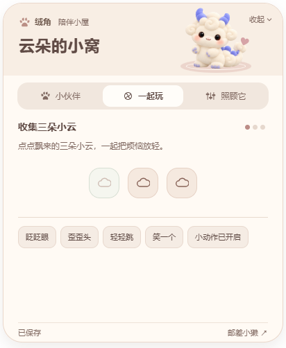</td><td align="center"><strong>青团 · 先左后右滚球</strong><br>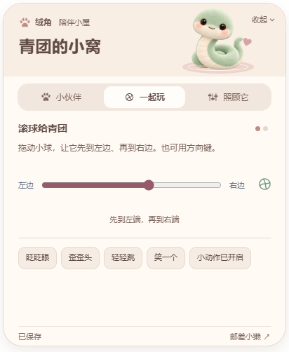</td></tr>
<tr><td align="center"><strong>踏踏 · 小踏步</strong><br>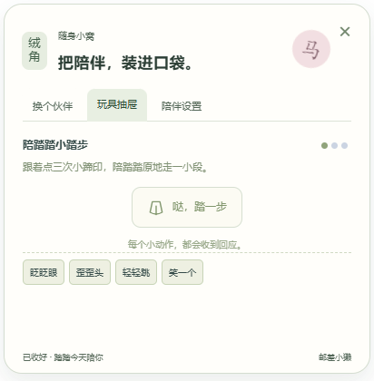</td><td align="center"><strong>绵绵 · 跟随呼吸</strong><br>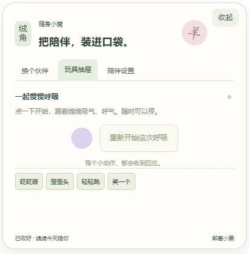</td></tr>
<tr><td align="center"><strong>桃桃 · 叶子躲猫猫</strong><br>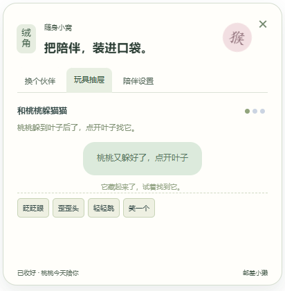</td><td align="center"><strong>啾啾 · 左右小翅膀</strong><br>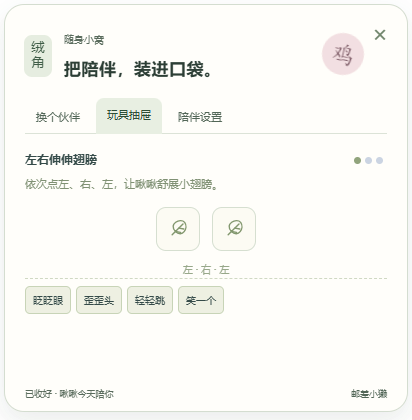</td></tr>
<tr><td align="center"><strong>旺仔 · 抛球互动</strong><br>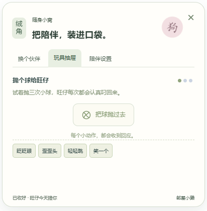</td><td align="center"><strong>噗噗 · 滑动舒展条</strong><br>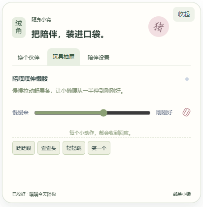</td></tr>
</table>

每张图都来自对应角色的真实玩具抽屉，并执行了一次点击、滑动或呼吸操作。

</details>

## 把伙伴放到桌面上

启动后，从系统托盘 / Mac 菜单栏打开 **小窝 / 设置**。Windows 图标可能位于托盘的折叠区。

<table>
<tr><td align="center"><strong>选择伙伴</strong><br></td><td align="center"><strong>定制昵称与相处节奏</strong><br>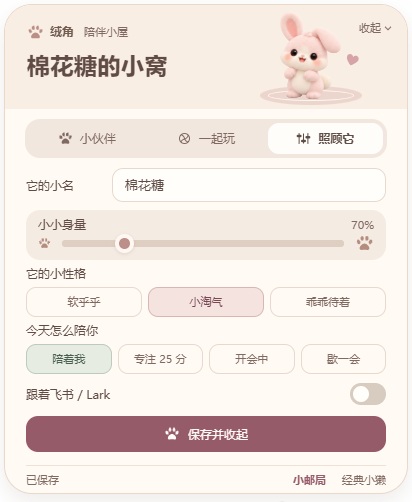</td></tr>
<tr><td align="center"><strong>玩一会：点亮小云</strong><br>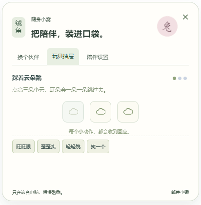</td><td align="center"><strong>换一种玩法：滚球</strong><br>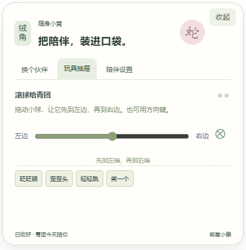</td></tr>
<tr><td align="center"><strong>专注 25 分钟</strong><br>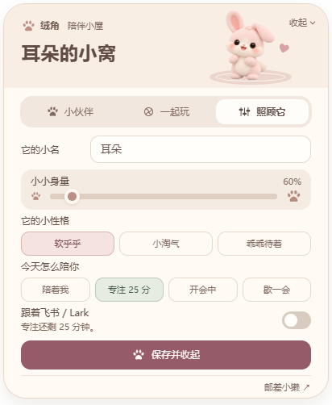</td><td align="center"><strong>经典小獭也在</strong><br>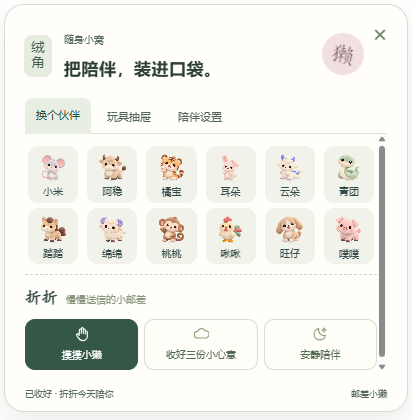</td></tr>
</table>

截图取自实际 Electron 小窝窗口，使用独立演示配置，裁切到设置面板；没有拍摄聊天内容或用户桌面。

**第一次使用可以这样做：**

1. 在“小伙伴”中选择生肖，立即保存。
2. 进入“照顾它”，填写 1–16 字小名，选择 **55%–130%** 身量，以及软乎乎 / 小淘气 / 乖乖待着三种相处节奏。
3. 点击 **保存并收起**，面板会收起；重启后会恢复设置。
4. 收起小窝，让它待在桌面角落；拖动宠物下方的名字标签即可搬家。
5. 需要安静时，在“照顾它”中选择专注、会议或休息。**这些是绒角本地模式，不会改变飞书账号状态。**

<details>
<summary>看看会议与休息模式</summary>

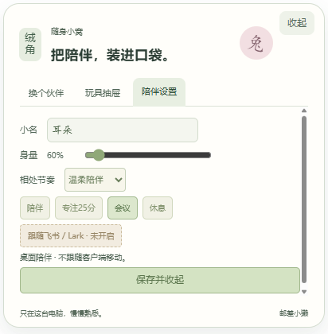
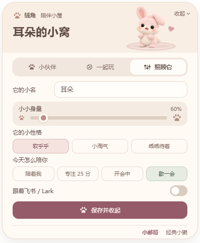

</details>

## 小邮局，让伙伴替你捎个信

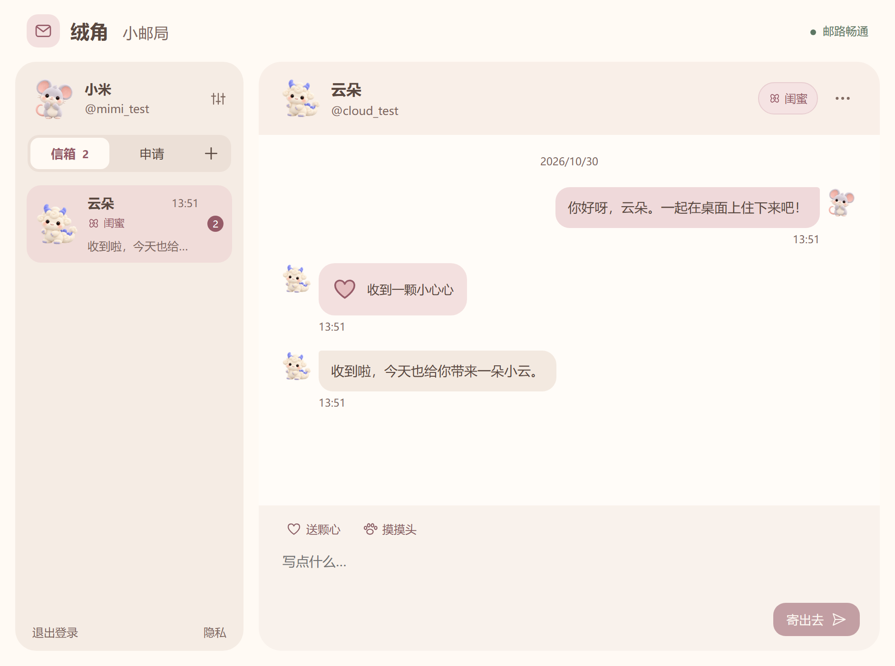

这是绒角自己的好友服务。注册并验证邮箱后，把绒角号告诉朋友；双方同意后，便能聊两句、送颗心，或轻轻摸摸对方的伙伴。

| 功能 | 怎么使用 |
| --- | --- |
| 注册 / 登录 | 邮箱验证后登录，可重发验证邮件与找回密码 |
| 搜索与加好友 | 点“＋”，输入完整绒角号；在“申请”中同意 |
| 关系绑定 | 聊天顶部“绑定关系”，选择称呼并邀请；对方确认后显示专属徽章 |
| 文字私聊 | 点好友进入聊天；Enter 发送，Shift+Enter 换行 |
| 小互动 | 聊天框上方“送颗心 / 摸摸头”，对方收到互动记录 |
| 桌面收信 | 小邮局收起后继续连接；桌宠提示来信，专注 / 会议 / 休息时安静更新未读 |
| 自己的小名片 | 昵称、生肖头像、允许被搜索；可屏蔽、举报、导出和注销 |

<details>
<summary>看看登录、找朋友和个人名片</summary>

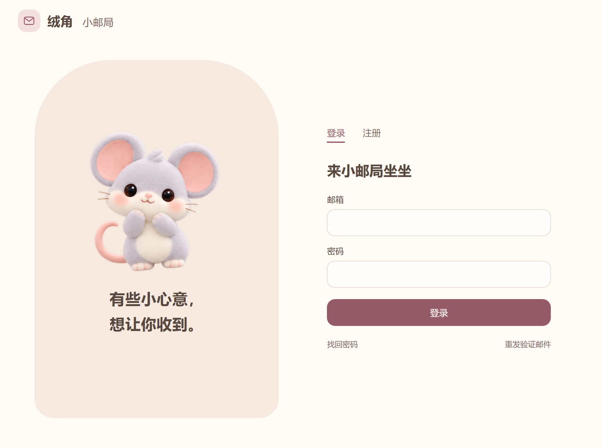
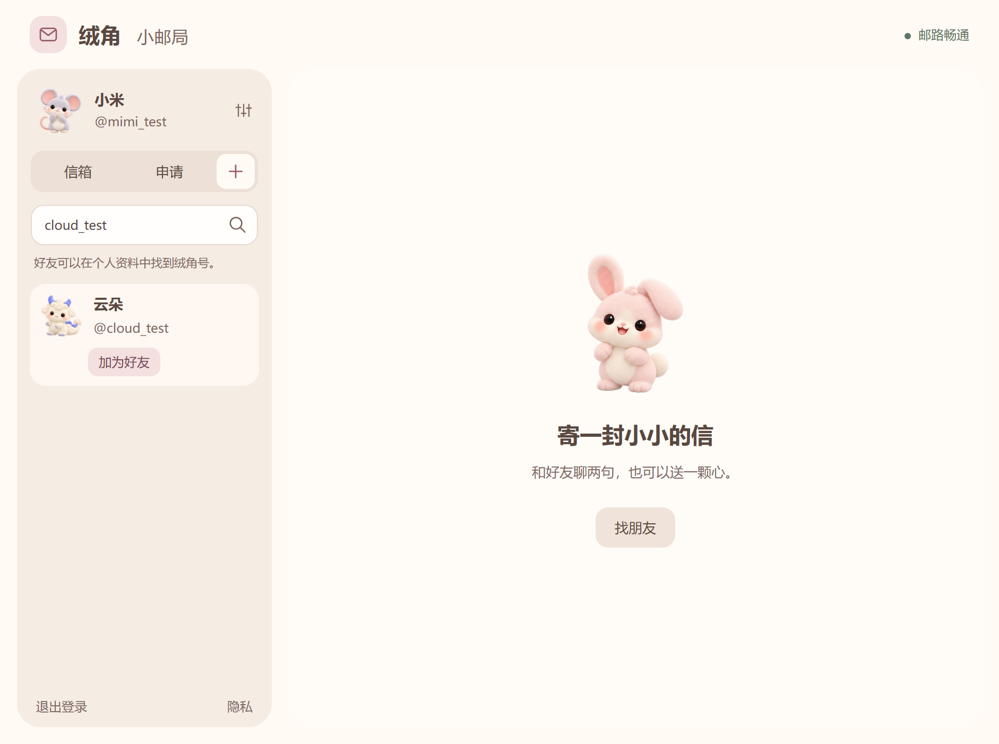
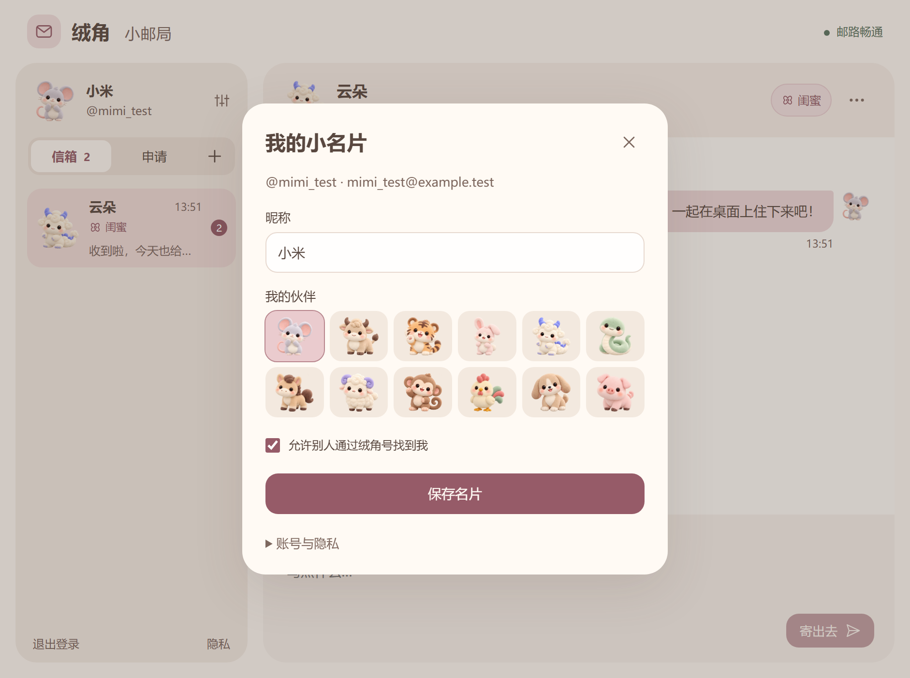

</details>

以上截图来自真实本地服务和两个测试账号，不含真实用户的私聊。小邮局账号独立于飞书 / Lark，不需要企业审批，也不读取企业联系人。

### 给你们一个特别的称呼

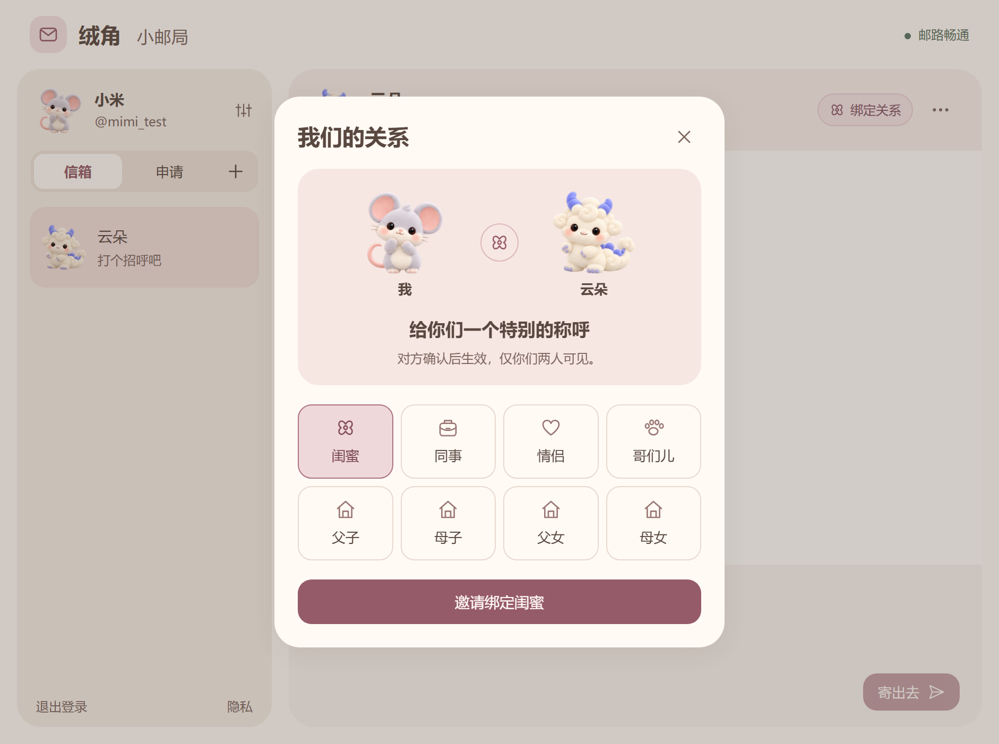

支持 **闺蜜、同事、情侣、哥们儿、父子、母子、父女、母女**。打开好友聊天，点顶部“绑定关系”发送邀请；对方在“申请”或聊天顶部确认。家庭关系还需要选择自己的身份，双方看到的爸爸、妈妈、儿子、女儿对应显示。

- 绑定后，好友列表与聊天顶部显示关系徽章；点开可看双方宠物和绑定日期。
- 每对好友同时保留一种关系；变更需再次确认，确认前原关系保持不变。
- 邀请 7 天有效，可以婉拒或撤回。任一方可解除绑定，聊天仍保留。
- 关系仅对双方可见，不展示在公开搜索中。删除好友、屏蔽或注销会清除绑定。

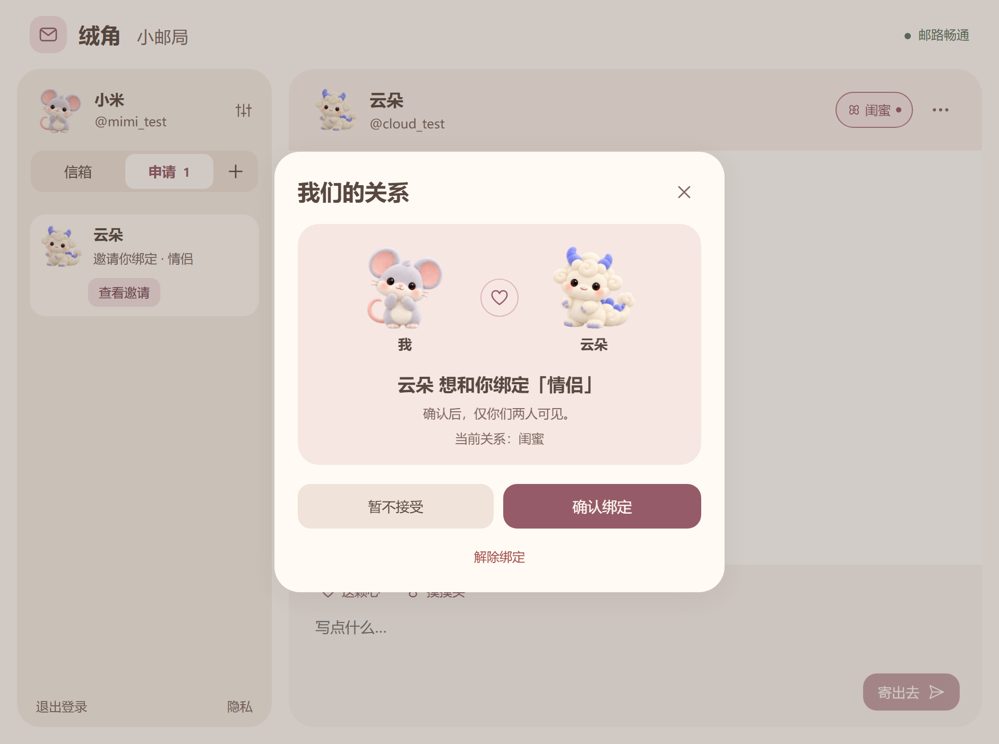

**只想使用：** 取得部署方的邮局地址后，在小邮局连接页填写，或运行一次：

```bash
node setup.mjs --postoffice https://你的邮局域名
```

**自己部署：** 本机试用需要 Node.js **24.15+**，运行 `node server/setup.mjs` 后打开 `http://127.0.0.1:4718/`；测试验证邮件写入 `.local/postoffice/outbox/`。公开服务需域名、常驻服务器和 SMTP 发信配置，已提供 Docker Compose 与 HTTPS 配置。

[完整部署、邮件配置与运营说明 →](docs/social-deployment.md)

## 和飞书 / Lark 一起使用

默认先作为独立桌宠运行。想让它贴着客户端窗外陪伴时：

1. 打开飞书或 Lark 桌面客户端。
2. 从托盘 / 菜单栏选择 **贴在飞书 / Lark 窗口外侧**；也可在“照顾它”中打开 **跟着飞书 / Lark** 开关，开启后面板自动收起。
3. 保持客户端处于前台，并给右侧或下方留一点空间。

| 客户端窗口状态 | 宠物的行为 |
| --- | --- |
| 前台、有外侧空间 | 优先停在右下角的右侧，其次下方 |
| 最大化、外侧放不下 | 收回托盘，避免占用聊天视野 |
| 最小化、切到其他应用、未找到客户端 | 暂时隐藏；可从托盘切回“桌面陪伴” |
| 恢复前台，重新有空间 | 再次出现在窗口外侧 |
| 主动打开小窝 | 设置面板移到屏幕内，方便操作 |

国内飞书使用默认命令；如需 Lark 标识，可运行：

```bash
node setup.mjs --brand lark
```

此选项用于启动标识，不会登录账号。窗口观察器识别本机客户端，只读取进程、前后台、最小化和窗口几何信息。**消息提醒、自动同步飞书状态、自动发送消息均未接入。**

| 平台 | 自动验收 | 实际客户端能力 |
| --- | --- | --- |
| Windows x64 | 单元、原生小窝、保存 / 重启、合成窗口定位检查通过 | 已提供窗口外侧跟随；真实多屏仍需试用 |
| macOS Apple Silicon | 同一源码的 CI、元数据桥、原生交互检查通过 | 真实客户端跟随与鼠标点击穿透待实机试用 |
| macOS Intel | 同一源码 CI 通过；虚拟机使用显式软件图形后端 | 实际 GPU 性能、客户端跟随与鼠标体验待实机试用 |

详细范围见 [平台验收说明](docs/platforms.md)。Windows ARM、Linux 和服务器无图形环境尚未作为受支持发布目标。

## 常用命令

在项目目录运行：

| 命令 | 用途 |
| --- | --- |
| `node setup.mjs` / `npm start` | 自动准备依赖并启动桌宠 |
| `node setup.mjs --configure` | 打开小窝设置 |
| `node setup.mjs --brand lark` | 使用 Lark 标识启动 |
| `node setup.mjs --repair` | 重新准备依赖，保留本地角色配置 |
| `node setup.mjs --no-start` | 只准备环境，不启动窗口 |
| `npm run preview` | 浏览器预览，默认打开 `http://127.0.0.1:4717` |
| `npm run doctor` | 查看本机与平台能力 |
| `node server/setup.mjs` | 启动本地小邮局（Node.js 24.15+） |
| `node setup.mjs --postoffice https://你的邮局域名` | 配置并连接已部署的小邮局 |

浏览器预览适合看形象和动作。桌面透明窗口、托盘、窗口外侧跟随需要用 `node setup.mjs` 启动；浏览器预览设置和桌面配置分别保存。

## 更新、备份与卸载

**更新**：先在托盘退出绒角，再进入原项目目录运行：

```bash
git pull --ff-only
node setup.mjs
```

ZIP 用户可用新版源码覆盖程序文件，保留 `.local/`。依赖或锁文件变化时，启动器会自动重新准备。不要跨 Windows / Mac 复制 `node_modules/`。

**备份**：复制项目目录内的 `.local/`。其中 `character.json` 保存生肖、昵称、身量、性格；`preferences.json` 保存模式与跟随偏好。高级用户可用兼容环境变量 `PAPERPAL_DATA_DIR` 指定其他数据目录。

**从 PaperPal 更新**：项目已更名为绒角 MofuCorner。原有数据格式与目录继续兼容，旧的 `Start-PaperPal.*` 入口也保留。已有 Git 克隆可先更新远程地址：

```bash
git remote set-url origin https://github.com/dengjihui1/mofu-corner.git
git pull --ff-only
node setup.mjs
```

**卸载**：退出宠物，按需要备份 `.local/`，再删除项目目录。当前不会添加开机启动项、系统服务或全局 npm 命令。

## 常见问题

<details>
<summary><strong>提示找不到 node / npm，怎么办？</strong></summary>

安装包含 npm 的 [Node.js](https://nodejs.org/)，重新打开终端，确认 `node -v` 至少为 22.12，且 `npm -v` 能显示版本。无需另装 Python、建模软件或编译工具。

</details>

<details>
<summary><strong>首次下载很慢，或 Electron 没下载成功？</strong></summary>

安装过程需要访问 npm 与 Electron 下载源。确认网络或代理可用后，在同一目录运行 `node setup.mjs --repair`。先用 `npm run doctor` 查看环境；错误日志在 `.local/logs/desktop.log`。

</details>

<details>
<summary><strong>启动后没看见宠物？</strong></summary>

先查看托盘 / 菜单栏是否有绒角图标，选择“显示宠物 · 桌面陪伴”。跟随模式下，如果客户端最小化、不在前台或窗口外放不下，宠物会隐藏。`node setup.mjs --configure` 可以主动打开设置。

</details>

<details>
<summary><strong>为什么看不到动作，或动作很少？</strong></summary>

先切回陪伴模式，并检查系统“减少动态”偏好。安静性格的活动间隔更长，专注 / 会议模式会减少动态；图形渲染需要 WebGL2。若始终无法显示，提交问题时附上系统、架构、Node 版本与报错。

</details>

<details>
<summary><strong>macOS 需要录屏、辅助功能或管理员权限吗？</strong></summary>

独立桌面陪伴不依赖这些授权。Mac 窗口观察器不主动申请录屏、辅助功能或 System Events 权限；不同系统版本可能限制窗口元数据，遇到限制可切回桌面陪伴。Mac 的真实客户端跟随仍按试用功能提供。

</details>

<details>
<summary><strong>可以通知新消息、聊天，或者生成我自己的宠物吗？</strong></summary>

小邮局已支持独立账号之间的好友私聊、心心、摸头和桌面未读提示，需要连接同一个已部署服务。飞书 / Lark 消息接收与状态同步、AI 对话、图片生成自定义宠物尚未开放。默认本地陪伴不会连接账号。

</details>

## 开发与截图复现

```bash
npm ci
npm run check
npm test
npm run test:desktop
npm run test:setup
npm run docs:screenshots
npm run package:source
```

- `docs:screenshots` 用临时配置启动隐藏 Electron 窗口，走真实 IPC 与界面操作，生成本文的小窝截图、生肖阵容和动作关键帧；不会修改你的 `.local/`。
- `package:source` 输出 `dist/mofu-corner-0.7.0-source.zip` 与 SHA-256，不包含依赖、本机数据或历史设计稿。
- 三平台检查与源码包可在 [GitHub Actions](https://github.com/dengjihui1/mofu-corner/actions) 查看。CI 的合成窗口定位不等同于真实飞书客户端人工验收。

| 目录 | 内容 |
| --- | --- |
| `desktop/` | 透明窗口、托盘 / 菜单栏、安全预加载与 IPC |
| `ui/` | 小窝、内置角色、连续轻动作与表情 |
| `src/` | 配置、存储、模式、窗口停靠与平台适配 |
| `platform/` | Windows / macOS 窗口元数据观察器 |
| `server/` · `deploy/` | 小邮局账号、好友、聊天与公开部署配置 |
| `scripts/` · `tests/` | 文档截图、源码打包与自动验收 |
| `design/current/` | 当前版本的真实截图和渲染器图集 |

[更新记录](CHANGELOG.md) · [发布说明](docs/publishing.md) · [隐私与权限](PRIVACY.md)

## English

**MofuCorner** is a local desktop companion with twelve plush zodiac characters, small continuous motions, expressions and simple games. Clone the repository and run `node setup.mjs` with Node.js 22.12+ and a WebGL2-capable desktop. Windows and macOS share the same source. Feishu / Lark window-edge companionship is available, with real-client macOS behavior still experimental. An optional self-hosted Post Office adds email-verified accounts, friend requests, private text chat and pet gestures. Its server requires Node.js 24.15+; no official public endpoint is bundled. Feishu / Lark messages, their account-status synchronization and AI conversation are not connected. No company app approval is needed for the default local companion.

## 致谢与许可

受 [feishu-pet](https://github.com/HeiGeAi/feishu-pet) 的办公宠物方向启发。项目代码与角色独立制作，毛绒图像由生成式工具辅助创作；界面优化使用 [taste-skill](https://github.com/Leonxlnx/taste-skill)。

项目使用 [MIT 许可证](LICENSE)，Three.js 遵循其 [MIT 许可](ui/vendor/THREE-LICENSE.txt)。绒角与飞书、Lark 及 Codex 官方无隶属关系。
