# 绒角 · 小邮局

把小心意，寄到朋友的桌面。

**[打开小邮局 →](https://mofu-corner-dengjihui1.netlify.app/)** · [桌宠主项目](https://github.com/dengjihui1/mofu-corner) · [部署与验收记录](DEPLOYMENT.md)

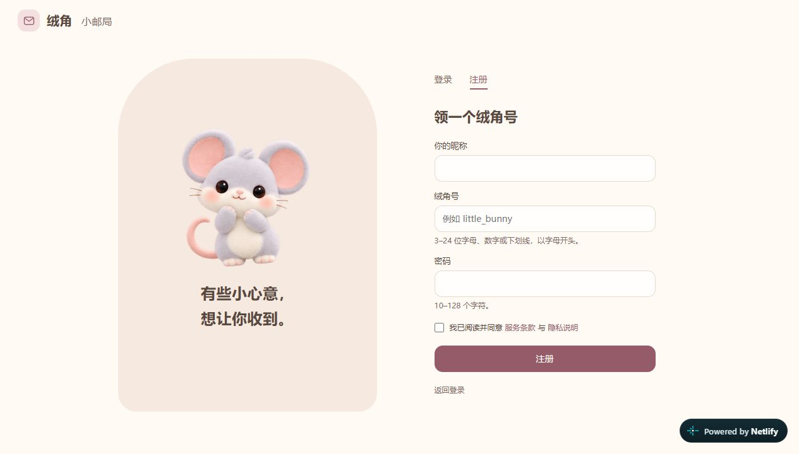

## 开始使用

1. 打开网址，选择「注册」，填写昵称、绒角号和密码。
2. 安全保存只显示一次的恢复码。无需邮箱、飞书企业应用或平台账号。
3. 把自己的绒角号告诉朋友。对方点「找朋友」，输入完整绒角号，发送申请。
4. 接受申请后可以私聊、送心心、摸摸头；聊天顶部可以发起关系绑定，双方确认后显示。
5. 点右上角「我的家」，领取搬家礼，用绒绒豆添置装饰、布置自己的小屋。

绒角号为 3–24 位字母、数字或下划线，以字母开头；密码为 10–128 个字符。密码与恢复码同时丢失时，当前无法找回账号。

关系支持闺蜜、同事、情侣、哥们儿、父子、母子、父女和母女。关系标签只对双方显示，任一方可解除。

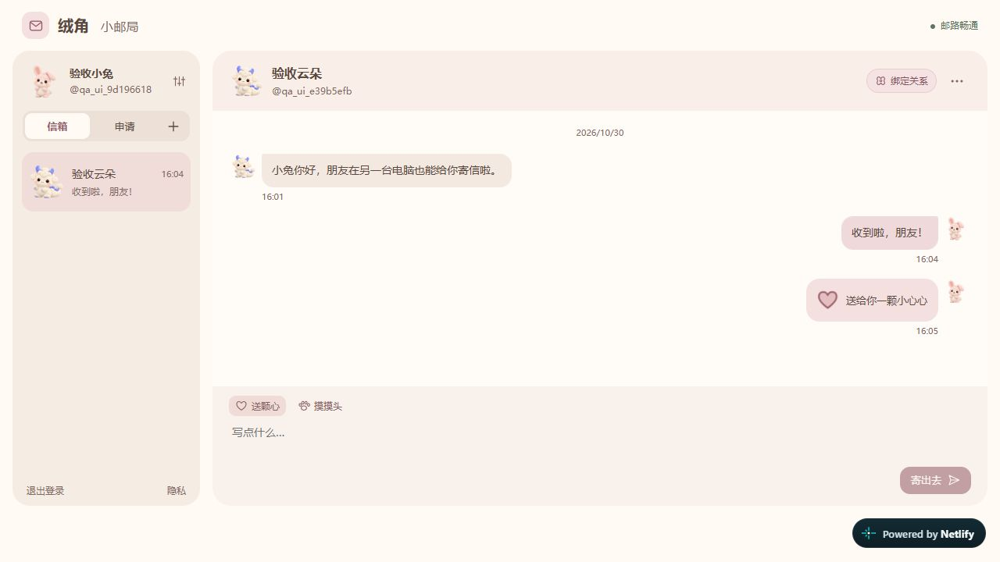

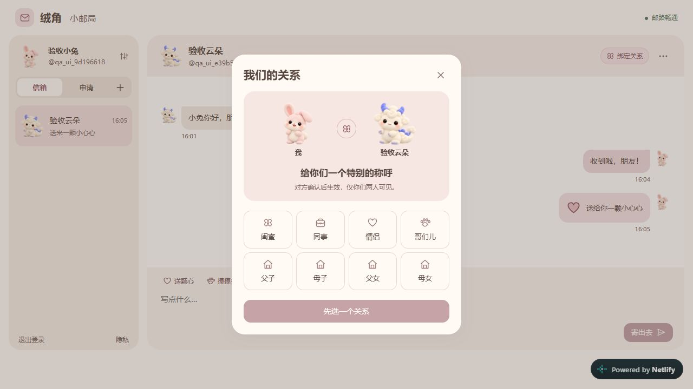

<details><summary>窄屏聊天界面</summary>

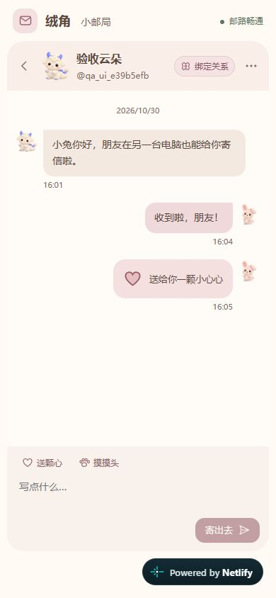

</details>

截图使用临时验收账号，拍摄后已清理，不含真实用户私聊。

## 四间可以直接分享的小屋

**[打开小屋灵感 →](https://mofu-corner-dengjihui1.netlify.app/showroom.html#berry/rabbit)** · 不用注册即可体验

- **奶油早餐**：黄油吐司沙发、曲奇软垫、小雏菊。
- **莓果茶会**：兔耳抱抱椅、莓莓花瓣毯、郁金香小夜灯。
- **森林来信**：抹茶豆袋、慢慢读小书架、窗边绿意。
- **月亮晚安**：月光蓝墙、云朵地毯、月亮落地灯。

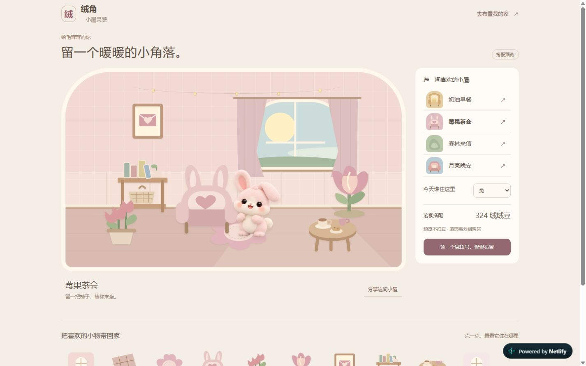

<details><summary>看看另外三间小屋和手机版</summary>

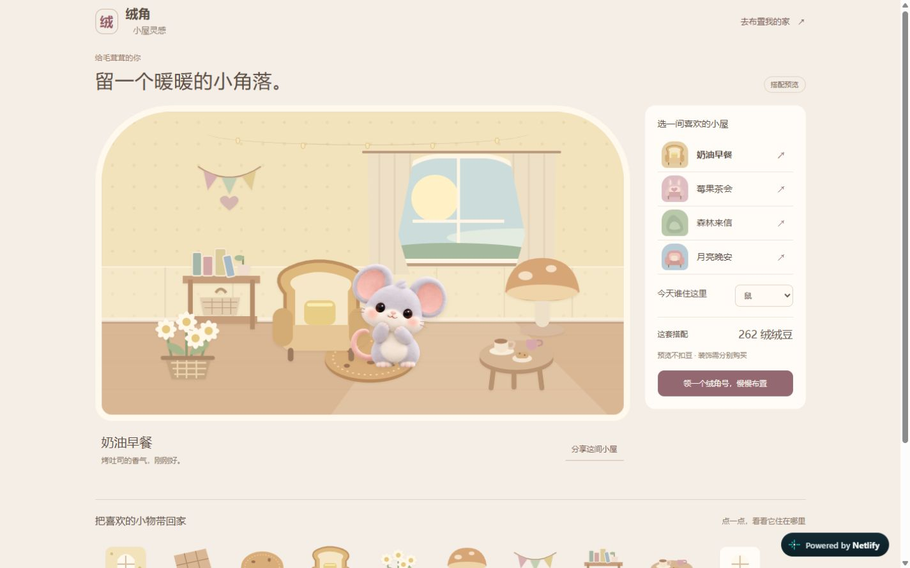
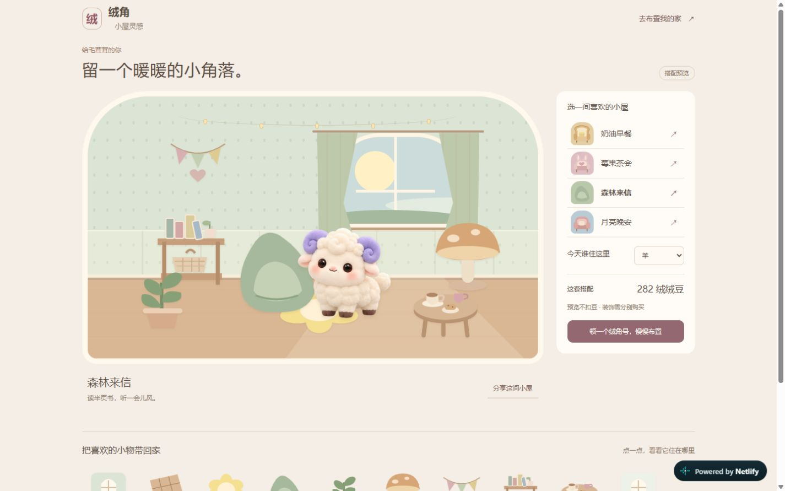
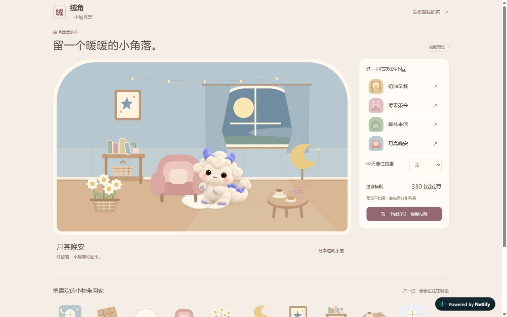
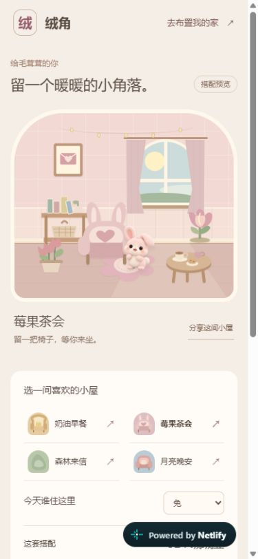

</details>

展示时可以切换十二生肖伙伴、点宠物打招呼、查看小物价格，再点「分享这间小屋」复制带当前主题和生肖的链接。图片加载完成后再替换场景，避免切换时宠物短暂消失。

登录后的「我的家 → 搭配灵感」也能整间试摆，并筛选出该搭配的装饰。**试摆不扣豆、不保存未购买的物品**；购买单件后回到真实布置。展示页的搭配价格来自商店同一份目录，不是付费套餐，也不会自动购买。

## 自己设计小屋，给伙伴换装

在「我的家」点 **自由布置**，拖动家具和伙伴；右侧可以调整大小、角度、前后层次、翻转和收起。键盘方向键移动，Shift + 方向键移动更远。点「保存布置」才写入账号，取消会丢弃这次草稿；另一个窗口先保存时，会提示冲突并保留草稿，取消后重新布置即可取得最新版本。好友串门看到的是你保存的设计。

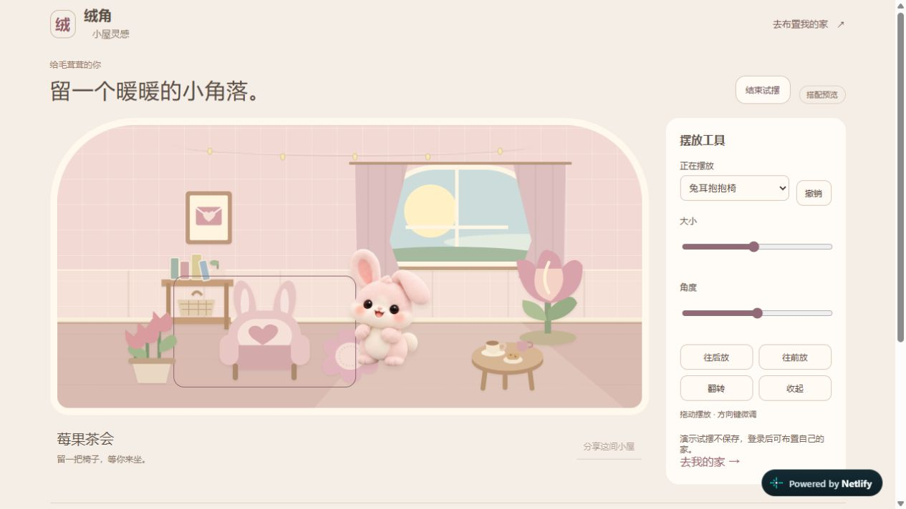

<details><summary>手机也可以拖动布置</summary>

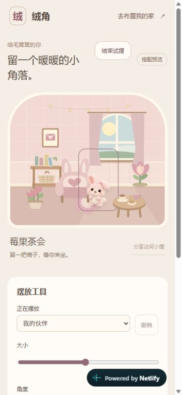

</details>

「小衣橱」提供头饰、围巾和挎包。奶油蝴蝶结、格子小围巾免费；其余使用绒绒豆购买。可以先试戴，再穿戴或取下。已穿戴的饰品显示在网页小屋、好友串门和好友/聊天头像中。桌面悬浮宠物的动画挂饰尚未接入；这里的衣橱属于账号小屋。

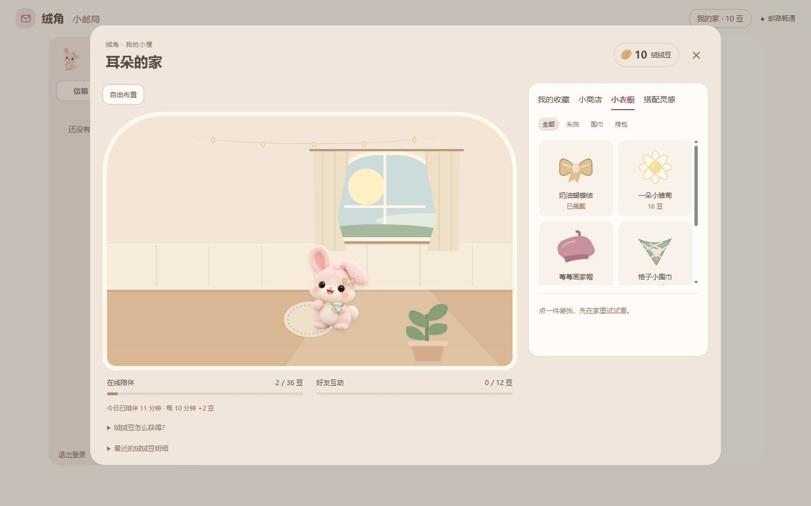

**生肖在注册时从十二生肖中选定，此后不可更换。** 已有账号保留当前伙伴；昵称和饰品可以修改。服务端会拒绝改换生肖，包括旧客户端和直接接口请求。

公开展示页的「试试自由布置」是免登录演示，结束或刷新后还原，不修改个人账号，也不通过分享链接传递这次临时布置。注册选生肖与公开样板间切换示例伙伴是两个不同操作。

## 我的小屋与绒绒豆

登录后点右上角 **「我的家」**。先试摆，再买下；拥有的装饰可以随时换回。目前提供 37 款内容，含 4 款免费基础装饰和 2 件免费饰品：墙纸、地板、地毯、座椅、花草、灯具、挂画、书架、茶几和聊天背景。

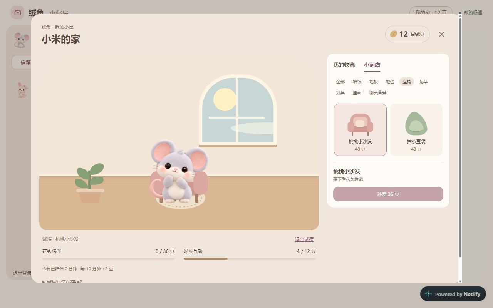

| 获得方式 | 绒绒豆 | 限制 |
| --- | --- | --- |
| 第一次入住 | 20 | 每个账号一次 |
| 在线陪伴 | 每 10 分钟 2 | 每天最多 36 |
| 与好友互相聊天 | 双方各 3 | 同一好友每天一次 |
| 互送心心或摸头 | 双方各 1 | 同一好友每天一次，两个动作共用额度 |
| 好友互动合计 | 每天最多 12 | 不按刷屏条数累加 |

每天北京时间零点更新可领取额度，余额保留。计时要求登录、联网并保持应用运行；电脑睡眠、断网不补时，多开窗口不加速。网页后台可能被浏览器暂停，长期桌面陪伴推荐使用桌宠连接本邮局。

在小商店里点装饰即可预览，确认购买后扣豆并自动使用。收藏、余额与布置跟随账号保存；好友聊天右上角「⋯ → 去 TA 家坐坐」可看对方的小屋。只有好友可串门，不展示对方的余额和账本。聊天背景只改变自己的聊天界面。

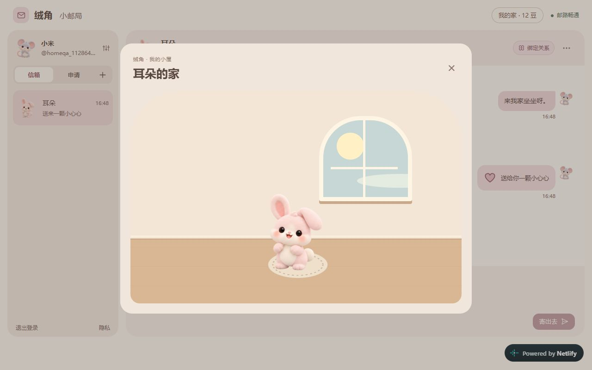

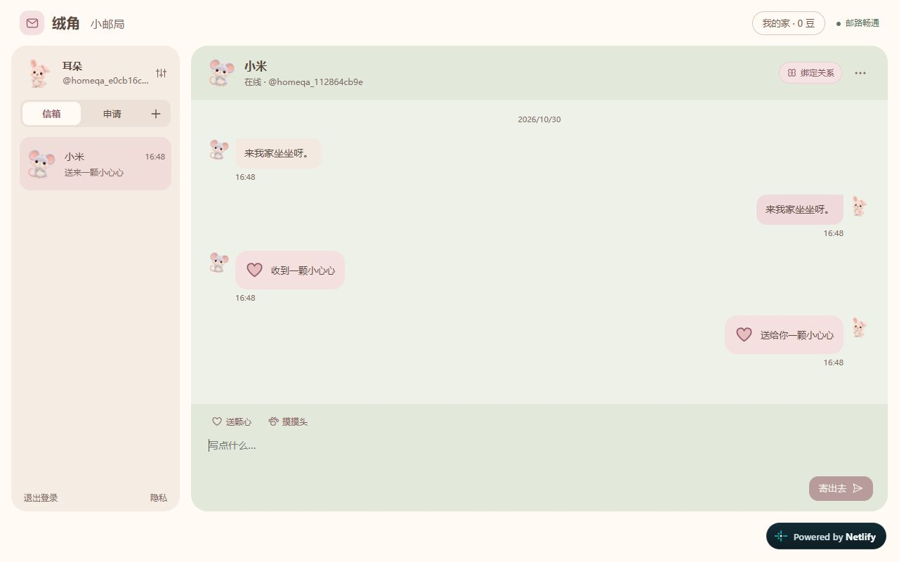

支持自由拖拽、缩放、旋转、翻转、前后层次、撤销和保存。每款拥有的家具可摆一件，同类不同款可同时摆放；目前不提供家具赠送或共同装修。绒绒豆没有充值、转账或提现功能；

<details><summary>手机上的小屋</summary>

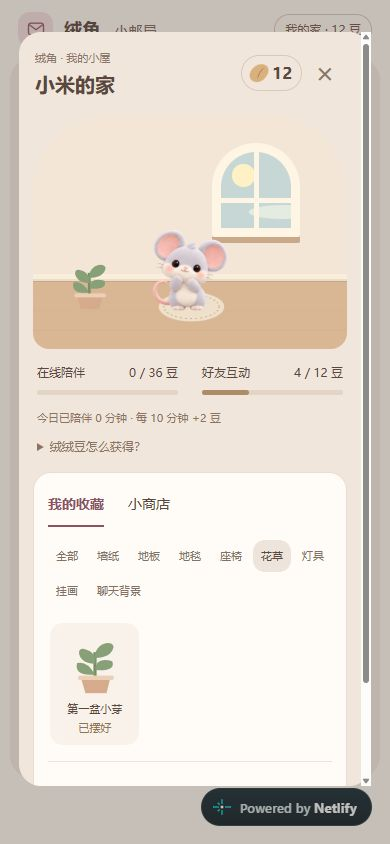

</details>

## 接到 Windows / macOS 桌宠

在主项目目录运行：

```sh
node setup.mjs --postoffice https://mofu-corner-dengjihui1.netlify.app
```

也可以在桌宠「小邮局」的连接页填入同一个网址。网页注册的账号可直接登录桌面小邮局；朋友必须连接同一个服务。浏览器版提供社交功能，悬浮桌宠需运行主项目。

## 免费额度与访问情况

当前使用 **Netlify Free + Turso Free**，不需要自行购买域名或发信服务。Netlify 账户已关闭自动充值，未配置银行卡。免费额度用完可能暂停服务，并非无限容量或流量。

| 服务 | 免费额度 |
| --- | --- |
| Netlify | 每月 300 credits，网站请求、流量、函数和生产部署共享 |
| Turso | 5 GB 数据、每月 5 亿行读取和 1000 万行写入 |

以 [Netlify](https://www.netlify.com/pricing/) 与 [Turso](https://turso.tech/pricing/) 的实际套餐为准。

2026-10-30：本网址国内 9 个节点访问健康接口，7 个成功；北京、无锡节点首次连接失败，随后对这两个地区的 3 个节点复测首页均成功。**存在网络波动，不能保证全国所有运营商与所有时段可用。** 账号、好友、聊天、恢复码、关系、退出登录及删除关联数据已通过公网验收。

## 自行部署

需要 Node.js 22.18+、Netlify Free 账号、Turso Free 账号。前端与函数同站托管，数据库使用 libSQL，引擎不要选择需要另一套 SDK 的 TursoDB。

```sh
npm ci
npm test
npm run build
```

1. 在 Turso 建立 libSQL 数据库。默认 Netlify 函数位于 Ohio，数据库选择同地域可减少函数与数据库间延迟。
2. 从 `.env.example` 查看变量名称。在安全终端环境配置数据库 URL 和令牌后执行 `npm run migrate`。迁移带校验记录，不导入本地演示账号。
3. 用 `npx netlify login` 登录，创建或关联自己的项目。仓库不携带原项目 ID。
4. 在 Netlify 设置 `TURSO_DATABASE_URL`，将 `TURSO_AUTH_TOKEN` 标记为 **Secret**，仅填 Production 值；不要填本地开发或 Agent Runner 环境，不要提交令牌。
5. 运行 `npx netlify deploy --prod`，再将已部署网站设置为 Public。免费方案可能显示 Netlify 标识。
6. 检查 `/api/health`、注册与好友聊天。需要公网自动验收时设置 `MOFU_TEST_ORIGIN` 后执行 `node tests/live.mjs`；它创建并清理两个临时账号，会消耗少量额度与注册限流次数。

`node tests/home-live.mjs` 可单独验收公网小屋、购买和互动奖励；同样使用 `MOFU_TEST_ORIGIN`，创建并清理两个合成账号。需要浏览器截图时加 `--inspect` 暂留账号，完成后务必执行 `--cleanup`；凭据只保存在被 Git 忽略的 `.local/`。

`npm start` 是本机内存数据库预览，地址 `http://127.0.0.1:4722`，重启后清空。它不会连接生产数据库。

## 数据与维护

当前生产服务端和数据库位于美国 Ohio，注册和聊天数据在该地域存储。隐私说明已公开列明托管方和存储地域。聊天未实现端到端加密；不读取飞书 / Lark 的消息或联系人。

提供屏蔽、举报、关闭搜索、导出与注销。聊天和举报保留 180 天，好友申请 30 天，关系邀请 7 天；清理由服务访问触发。维护者需处理举报，并关注免费额度。不要把这项免费服务作为重要资料的唯一存储。

只有 `public/` 和函数构建产物需要上传。`.local/`、`.netlify/`、环境文件、测试账号和密钥都不应提交到仓库。
